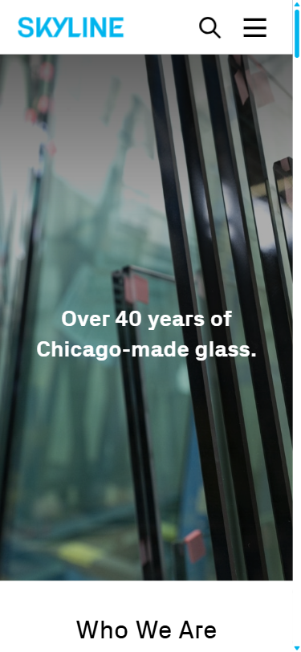

# BUG-001: Mobile hamburger menu is not keyboard focusable

**Test Case:** TC-ABOUT-A11Y-006
**Feature:** about
**Flow:** accessibility-basics
**Priority:** High
**Severity:** High
**Date Found:** 2026-10-30
**Source Report:** reports/about-critical+high-2026-10-30-181144

## Description
At the mobile viewport the hamburger is a `` with no `tabindex`, `role` or `aria-label`, so keyboard and assistive-technology users cannot reach it and cannot open the navigation menu.

## Steps to Reproduce
1. Open /about/ on the dev environment and wait for the page to finish loading (about 3 seconds, so hero animation completes)
2. Press Tab until the hamburger receives focus
3. Press Enter
4. Close it, then repeat with Space

## Expected Result
The hamburger is reachable with Tab, shows a visible focus indicator, and opens/closes the menu with Enter and Space (currently it is a  without tabindex or role).

## Actual Result
At 375x812 the hamburger is a  with no tabindex, role or aria-label. Tab order went skip-link -> logo -> body content links; the hamburger never received focus (also not within 40 Tab presses on retry), so Enter/Space could not be tested on it.

## Screenshot

## Environment
- Environment: dev
- URL: https://dev.skyline.glass/
- Browser: Playwright default chromium (viewport 375x812)

## Console Errors
None
