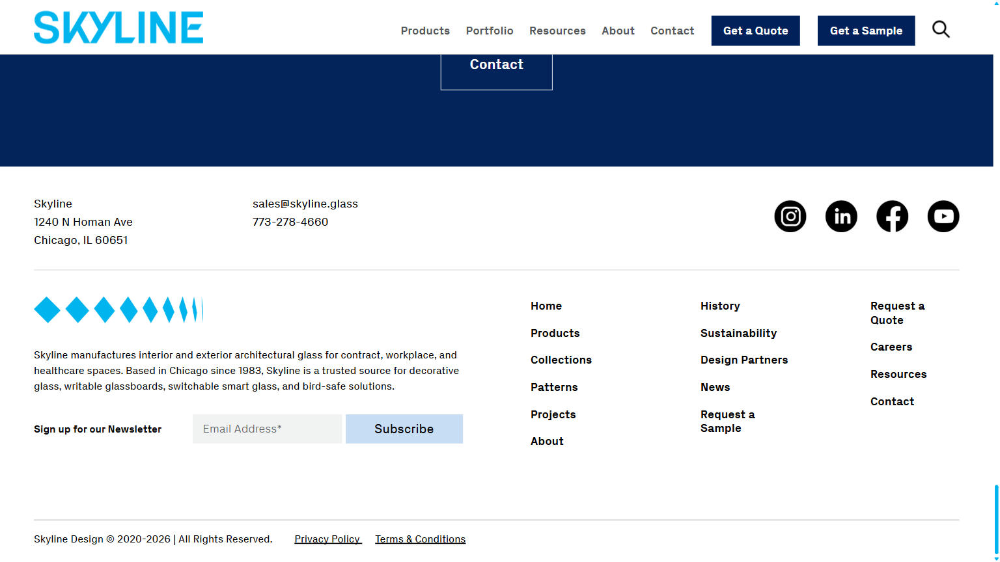

# BUG-002: YouTube social link in footer uses http:// instead of https://

**Test Case:** TC-ABOUT-CTA-008
**Feature:** about
**Flow:** cta-and-footer-contact
**Priority:** High
**Severity:** Low
**Date Found:** 2026-10-30
**Source Report:** reports/about-critical+high-2026-10-30-181144

## Description
The footer YouTube link points to `http://www.youtube.com/@skyline-glass`, while the other three social links use HTTPS. Users are sent through an insecure scheme on an HTTPS site; whether the destination redirects to HTTPS was not verified.

## Steps to Reproduce
1. Open /about/ on the dev environment and wait for the page to finish loading (about 3 seconds, so hero animation completes)
2. Scroll to the footer
3. Read the href of each social link and check its scheme

## Expected Result
All four hrefs start with https://. An http:// link is a defect (the browser blocks it as Mixed Content).

## Actual Result
Footer social hrefs: Instagram https://, LinkedIn https://, Facebook https://, YouTube http://www.youtube.com/@skyline-glass (not HTTPS). Same result on both attempts.

## Screenshot

## Environment
- Environment: dev
- URL: https://dev.skyline.glass/
- Browser: Playwright default chromium (viewport 1536x864)

## Console Errors
None
