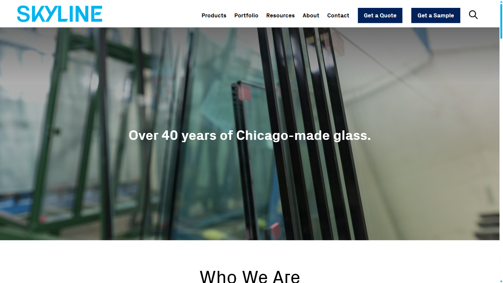

# BUG-003: Page H1 is empty; hero text is rendered in a div

**Test Case:** TC-ABOUT-META-003
**Feature:** about
**Flow:** page-metadata-and-hero
**Priority:** High
**Severity:** Medium
**Date Found:** 2026-10-30
**Source Report:** reports/about-critical+high-2026-10-30-181144

## Description
The only `<h1>` on the page is empty, and the hero text "Over 40 years of Chicago-made glass." is rendered in a `
`. Screen-reader users and search engines get no main page heading.

## Steps to Reproduce
1. Open /about/ on the dev environment and wait for the page to finish loading (about 3 seconds, so hero animation completes)
2. Inspect the page headings and count elements with tag h1
3. Read the text content of the h1

## Expected Result
Exactly one <h1> exists and its text is "Over 40 years of Chicago-made glass." (currently the h1 is empty and the hero text is in a 
 — confirmed defect).

## Actual Result
Exactly one <h1> exists but it is empty (innerHTML is a single space); the hero text "Over 40 years of Chicago-made glass." is rendered in a 
 instead. Reproduced on both attempts.

## Screenshot

## Environment
- Environment: dev
- URL: https://dev.skyline.glass/
- Browser: Playwright default chromium (viewport 1536x864)

## Console Errors
None
